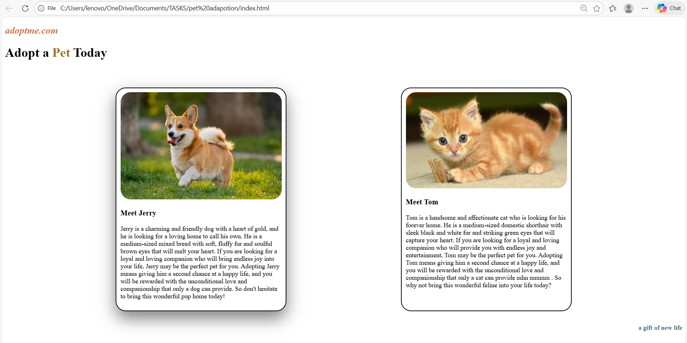

# 🐾 AdoptMe – Pet Adoption mini task

AdoptMe is a simple and responsive pet adoption webpage built using **HTML** and **CSS**.  
The website showcases pets available for adoption with a clean card-based layout and hover effects.

---

## 📌 Features

- Responsive pet cards using **Flexbox**
- Hover shadow effect on pet cards
- Clean and attractive UI
- Media query support for smaller screens

---

## 🛠️ Technologies Used

- HTML5
- CSS3 (Flexbox & Media Queries)

---

## screenshot

